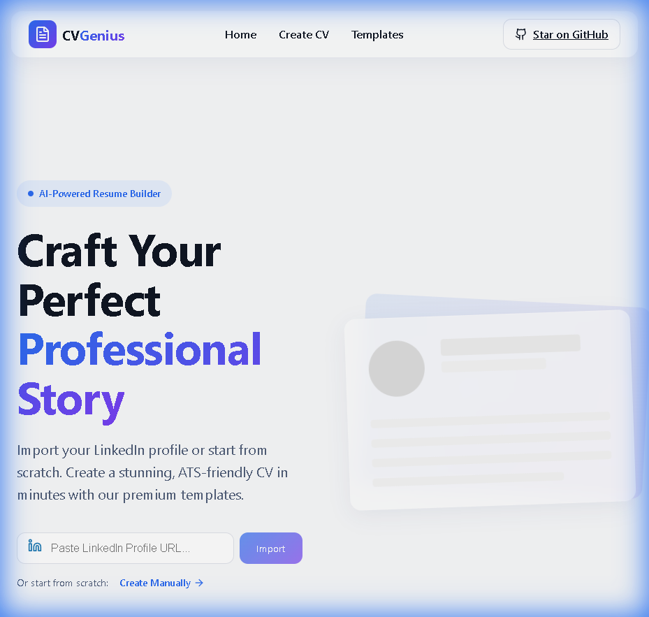

# Modern CV Generator



A premium, React-based CV generator featuring a modern design system, real-time preview, and simulated LinkedIn integration.

## 🚀 Features

- **Modern Design**: Built with a custom HSL color system, glassmorphism effects, and smooth Framer Motion animations.
- **LinkedIn Integration**: Simulate importing your profile data by pasting your LinkedIn URL.
- **Real-time Editor**: Split-screen view with instant updates as you type.
- **Multiple Templates**: Choose between "Modern" and "Creative" layouts.
- **Print / Save as PDF**: Open the browser print dialog from the editor, then choose Save as PDF to export the active template.

## 🛠️ Tech Stack

- **Frontend**: React, Vite
- **Styling**: Vanilla CSS (Variables & Modules)
- **Animations**: Framer Motion
- **Icons**: Lucide React
- **Routing**: React Router DOM

## 📦 Installation

1.  Clone the repository:
    ```bash
    git clone https://github.com/yourusername/cv-generator.git
    ```
2.  Install dependencies:
    ```bash
    npm install
    ```
3.  Start the development server:
    ```bash
    npm run dev
    ```

## 🔗 LinkedIn Simulation

To customize the "Import LinkedIn" feature for your own profile:
1.  Open `src/data/userProfile.js`.
2.  Paste your exact LinkedIn details.
3.  In the app, paste your LinkedIn URL to see your data populate instantly!

## 📄 License

MIT
